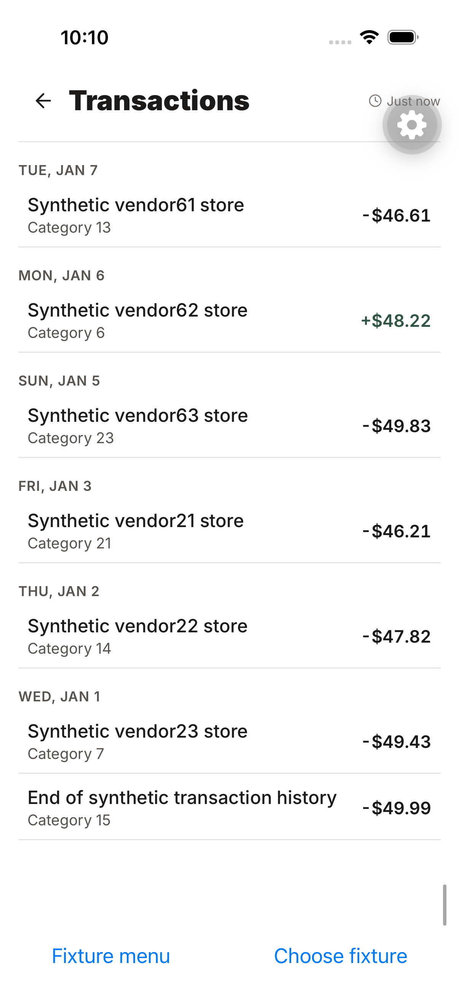
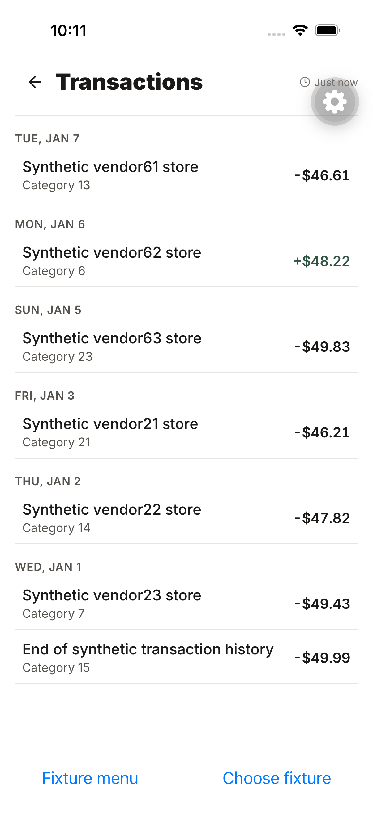

# November 4 fresh local native acceptance

Source: `/Users/andrewwatanabe/Kwilt`, branch `codex/budget-native-acceptance`.
JavaScript and flow candidate: `4a69616f16d516301ea5321f8c41f0b839de68ab`.
The passing flow started with precisely that source patch uncommitted and it was
committed during the run without changing the served source. Native binary was
freshly generated and built from `db7856ba3cc7bafd5d4096b87ec90ed1b52fca37`;
subsequent changes were JavaScript, tests and runner configuration only.

- Xcode 26.6; iPhone 17 Pro / iOS 26.5, isolated Simulator
  `282D12B9-82BD-4D37-8DAF-A8A08F2EECAD` (Kwilt PR203 acceptance).
- Kwilt 2.0.2 (135), Debug Simulator build. Derived data:
  `/tmp/kwilt-native-db7856ba-derived`.
- Node 22.23.2, Maestro 2.12.1, Temurin 17.0.21+9.
- Metro port 8081, project `scripts/money/native-harness`, owned and stopped by
  `scripts/e2e/run-maestro-ios.sh`. Original Simulator was shut down and its data
  preserved; no second local runtime was running.
- Prebuild and native build suppressed local dotenv loading with a temporary
  process preload so no production configuration was embedded.

## Passing native checks

`e2e/budget-fixture/navigation-inventory.yaml` exited zero at approximately
17:11 UTC on November 4. [Command receipts](navigation-inventory-commands.json)
retain the individual completed assertions:

1. Budget options → Accounts & connections → Manage accounts → Back → Budget.
2. Same Accounts entry → main menu → Budgets → Budget overview.
3. Stale transaction warning → real downward swipe → warning gone → exactly
   one completed refresh in the fixture readback.
4. All history reports 4000 of 4000; oldest transaction initially absent;
   scroll through the inventory to the unique oldest transaction.
5. Open that transaction, return, and verify the oldest row is still visible.

## Failures reproduced and repaired

The first fresh launch was covered by Expo's developer tutorial. The runner now
passes the installed Expo launcher’s `disableOnboarding=1` project URL option;
this disables only the developer tutorial, not Kwilt onboarding or authentication.

The Budget menu then appeared visually but its items were absent from native
accessibility. Its animated ancestor had zero height around absolutely positioned
content. Giving that ancestor absolute-fill bounds and `box-none` pointer events
made item discovery and selection pass. The new component regression fails on the
original source. An attempted accessibility-modal flag change was ineffective and
was removed. The fixture picker additionally needs centered scrolling because a
control below the scroll viewport can appear in the accessibility tree behind its
fixed footer.

## Boundaries

This is synthetic-data local Simulator acceptance using production screens and
routing with fixture provider adapters. It does not establish production provider,
physical-device, TestFlight or hosted iOS 26.4 results. General app smoke tests and
hosted native CI remain separate gates. No merge or TestFlight build is implied.

Full local diagnostics (including failed attempts) remain under the temporary
run directory recorded in `/tmp/kwilt-local-native-path`. Build log:
`/tmp/kwilt-local-native-build.log`; successful flow log:
`/tmp/kwilt-local-budget-maestro-6.log`.

## General smoke gate diagnosis

The CI-equivalent credential-free full-app run reached `App misconfigured` with
missing Supabase URL and key. Its auth assertion failed; the remaining suite was
interrupted after that setup failure, rather than counted as completed tests.
Diagnostics: temporary run directory `maestro-general-missing-config`.

A second diagnostic run supplied `http://127.0.0.1:55439` (no listener) and a
literal fake publishable-key placeholder through the process environment, with
local dotenv still disabled. On the unchanged app candidate, `auth-gate-smoke`
passed in 15 seconds, showing Apple and Google sign-in choices. This proves
signed-out rendering only, not successful authentication or a backend connection.
`smoke-devtools` failed in 21 seconds because the app remained signed out, as its
production auth gate requires. No auth bypass was introduced. The other three
legacy flows require the same signed-in shell and were not rerun after this
precondition was established.

At inspection, repository Actions secrets contained only the release read token,
and connected project inventory contained Kwilt but no identified Kwilt staging
project. The legacy flows need an explicitly isolated signed-in UI fixture or a
non-production test identity/session before their original assertions can run.
The three legacy interaction flows also target `nav.drawer.item.DevTools`,
which no longer exists in the current navigation UI; after isolated setup they
need current supported DevTools entry routing while retaining their interaction
assertions. Do not call this gate green based on Budget success.

Source patch `4a69616f` passed local verification and the uncached integration gate
(111 related Jest suites, 786 tests, typechecks and static checks). Independent
review found no blocking issues. Fresh hosted native run `41874825438` was queued
without a runner at this record's update; PR CI `41874758666` was running. These
statuses require live verification before integration.
