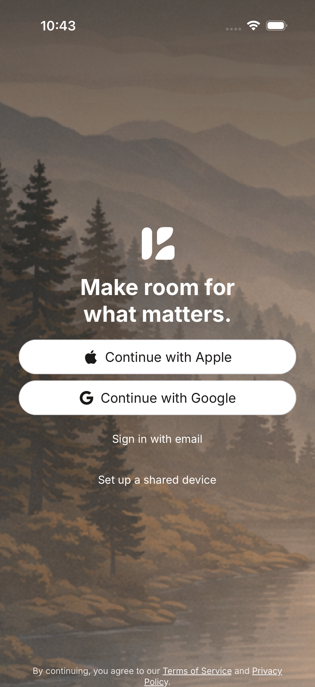
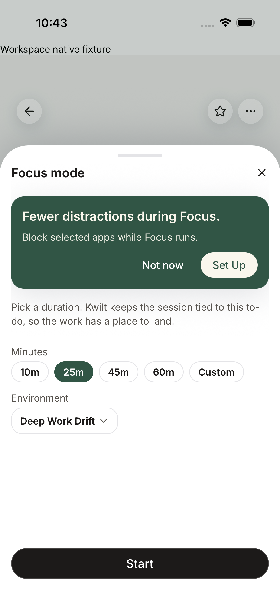

# November 4 consolidated local native smoke acceptance

All five smoke flows passed on the final reviewed source patch after `93f5a5f1`.
The [candidate receipt](candidate.json) records its source hashes, native build
revision and tooling. Source checkout: `/Users/andrewwatanabe/Kwilt`, branch
`codex/budget-native-acceptance`; these changes were uncommitted during testing.
The Debug host was freshly generated/built as 2.0.2 (135) from `db7856ba`; later
changes are JavaScript, test fixtures and CI configuration, not native code.

Final runs ended approximately 17:45 UTC. Both runner invocations exited zero:

| Flow | Evidence |
| --- | --- |
| Real app signed-out Apple/Google choices | [Commands](auth-gate-smoke-commands.json) |
| Workspace → existing DevTools deep link | [Commands](smoke-devtools-commands.json) |
| Plan-ready guide → To-do → accessible Focus setup | [Commands](onboarding-plan-ready-touch-regression-commands.json) |
| Arc banner → Curated → scroll/select bundled image → reopen banner | [Commands](arc-banner-touch-regression-commands.json) |
| Focus open/close → Schedule open/close → Focus open/close again | [Commands](activity-detail-key-actions-commands.json) |

The four workspace flows completed together in 1m59s. A separate real-app auth
run passed immediately before them. The runner owned and stopped Metro on port
8081 with project `scripts/e2e/native-harness`. Original Simulator data remains
preserved in the shut-down original device; only the disposable acceptance device
was active. No real account or backend credentials were used.

## Repairs exercised

- Dedicated auth/workspace fixture modes supply isolated configuration and
  memory-only storage. Auth mounts unchanged `App.tsx`; workspace mounts its
  production navigation/overlay subtree, without forging an identity/session.
- Workspace startup waits for navigation readiness and uses the existing
  development deep link instead of a removed drawer-menu item. Obsolete control
  labels/IDs were updated in both legacy and isolated interaction flows; parity
  and protected verification selection have regressions.
- The persistent empty Focus menu portal was modal to native accessibility and
  hid all visible setup controls. Its container is now non-modal; actual menus
  retain their own modal accessibility behavior. The regression failed before
  the repair and passed after it. Native handoff, Focus close and reopen passed.
- Expo's native developer FAB intercepted Schedule close taps outside its visible
  gear icon. The fixture disables that developer-only FAB and verifies its
  absence. This changed the disposable test host, not production behavior.

## Boundaries and retained diagnostics

This is local iOS 26.5 UI integration evidence. It does not prove provider login,
production sync, calendar writes, physical-device behavior or TestFlight delivery.
The broader nightly authenticated/backend suite is separate. The isolated Budget
flow has its own [passing receipt](../budget-native-2026-11-04/README.md).

Hosted run `41874825438` failed without executing native steps: the smoke job was
cancelled before runner execution, and its steps list was empty. Earlier hosted
iOS 26.4 initialization-crash reproduction therefore remains unverified there.
A new hosted run must use the checkpoint containing these repairs.

Full diagnostics remain in the temporary directory recorded by
`/tmp/kwilt-local-native-path`; final logs are `/tmp/kwilt-final-auth.log` and
`/tmp/kwilt-final-workspace.log`. Failed attempts are retained separately.

## Hosted run and cold-bundle correction

Run [41881405171](https://github.com/mtkinji/lomo/actions/runs/41881405171)
on `c490f49c` built successfully but failed its UI jobs. Auth's screenshot showed
**Bundling 43%**, and its device log requested the manifest's Hermes/lazy
`index.ts.bundle` URL. The runner had warmed a generic `index.bundle` variant.
Workspace's cold graph took 450,206 ms; three URL opens timed out, and the fourth
flow captured a development-server connection error. These are startup failures,
not passing interaction tests. No recurrence of the prior native crash is claimed.

The follow-up obtains Expo's iOS manifest and warms its exact local launch asset
before Maestro, with a bounded fifteen-minute bundle deadline. Malformed or
nonlocal manifest assets fail closed. Regression tests failed before this fix;
all 16 runner tests now pass, and local signed-out native acceptance passed again.

Hosted Budget navigation and real pull-to-refresh (one completed refresh) passed.
Scrolling reached older rows but exhausted the ten-minute traversal limit before
the final row. The allowance is now twenty minutes; the full 4,000-row scope,
final-row assertion, and detail/return assertions remain unchanged. This needs a
new hosted pass; the earlier local final-row pass does not replace that gate.

Original full diagnostics are retained locally at
`/tmp/kwilt-maestro-41881405171` and in the run's seven-day artifact. PR CI
[41881686222](https://github.com/mtkinji/lomo/actions/runs/41881686222) and backend
preflight [41881409765](https://github.com/mtkinji/lomo/actions/runs/41881409765)
passed on `c490f49c`. No merge or TestFlight upload occurred.
